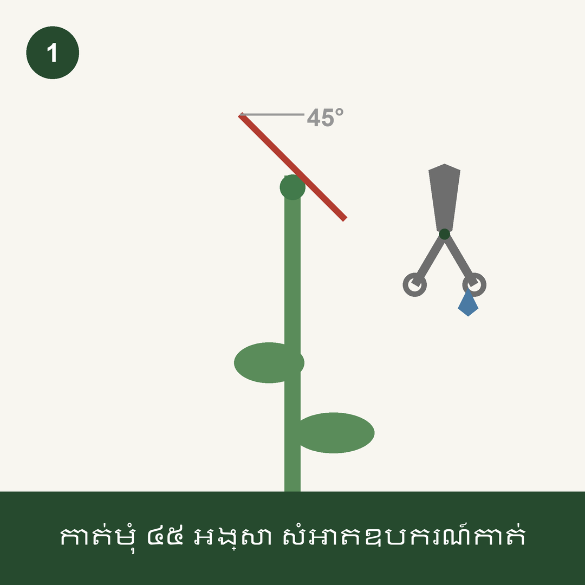
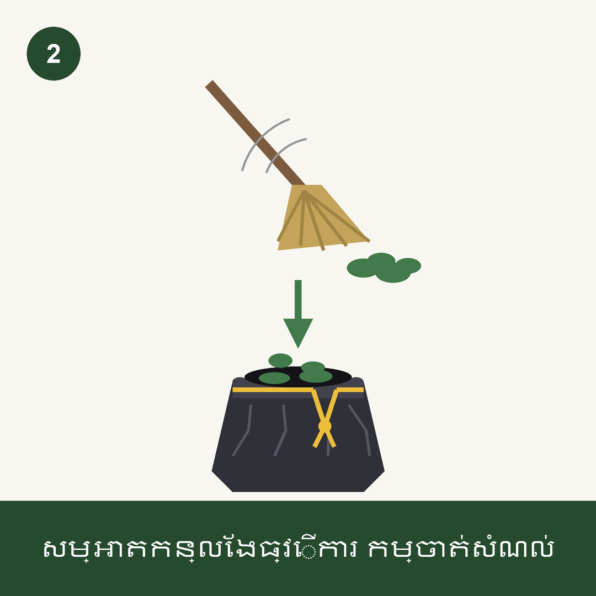

# pruning-telegram-demo

Pruning work standards as **pictures**, delivered to field workers' phones over a **Telegram bot**.

A small demo built for landscaping / plantation maintenance sites in Cambodia, where the
supervisor writes in Japanese or English and the crew speaks Khmer. A printed manual stays in
the office; a picture on a phone reaches the person actually holding the shears.

| Standard 1 — cutting technique | Standard 2 — site cleanup |
| --- | --- |
|  |  |
| `កាត់មុំ ៤៥ អង្សា សំអាតឧបករណ៍កាត់`<br>*Cut at a 45° angle. Disinfect the tool.* | `សម្អាតកន្លែងធ្វើការ កម្ចាត់សំណល់`<br>*Clean the work area. Dispose of the cuttings.* |

Design rules for the artwork: flat-icon style readable at a glance like a safety poster, **no
Japanese and no English inside the image**, and one short Khmer caption per image (numerals and
the degree symbol excepted).

## How it works

1. `generate_images.py` draws the work-standard images with Pillow — no stock art, everything is
   drawn in code, so a standard can be edited and regenerated.
2. `cli_send.py` asks who to send to (one, several, or `all`) and which standards to send, shows a
   confirmation, then sends through the Telegram Bot API. One image goes as a photo, two or more as
   a single album.
3. A new worker scans a QR code, opens the bot and presses START. `sync_accounts.py` then picks up
   that chat and adds them to the recipient list.

Telegram does not let a bot message someone who has never messaged it first — that first START is
required, and it is why the QR code exists.

## Files

| File | What it does |
| --- | --- |
| `generate_images.py` | Draws the two work-standard PNGs into `output/` |
| `cli_send.py` / `run_cli_send.bat` | Interactive sender: pick recipients (`all` supported) and standards |
| `sync_accounts.py` / `run_sync_accounts.bat` | Adds workers who have messaged the bot to `accounts.json` |
| `generate_bot_qr.py` | Builds the QR code used to onboard a new worker |
| `get_chat_id.py` | Prints the chat IDs the bot has seen, for filling in `.env` |
| `send_telegram.py` | The first version: sends both standards to one fixed chat |
| `telegram_api.py` | Thin wrapper around `sendPhoto` / `sendMediaGroup` |

## Setup

```bash
pip install -r requirements.txt
```

1. Create a bot with [@BotFather](https://t.me/BotFather) on Telegram and copy the token.
2. Copy `.env.example` to `.env` and fill in `TELEGRAM_BOT_TOKEN`.
3. Send any message to your new bot from your own Telegram account, then run
   `python get_chat_id.py` and put the chat ID it prints into `TELEGRAM_CHAT_ID`.
4. `python generate_images.py` to produce the images.
5. `python cli_send.py` to send them. (`python sync_accounts.py` first, to build the recipient list.)

`.env` and `accounts.json` are gitignored — the token and the recipient list never leave the
machine. `accounts.example.json` shows the recipient-list format.

## Limitations

This is a demo, not a deployed system.

- **The Khmer captions are machine-translated and have not been checked by a native speaker.**
  Verify them before putting anything like this in front of a real crew.
- `generate_images.py` and `generate_bot_qr.py` load Windows system fonts by absolute path
  (`C:\Windows\Fonts\...`). Other platforms need those paths changed to a font with Khmer coverage.
- `sync_accounts.py` polls `getUpdates` once, at the moment you run it. There is no background
  listener, and Telegram drops old updates, so run it after a new worker has messaged the bot.
- There is no delivery confirmation beyond the API response — the CLI reports what the API accepted,
  not what a worker read.

## 日本語の概要

カンボジアの植栽・造園の現場を想定したデモです。剪定の作業基準を、文字に頼らないイラスト
（説明はクメール語の短文のみ）にして、Telegram の bot で作業者のスマートフォンに送ります。
画像は Python（Pillow）でコードから描いているので、基準を直して作り直せます。送信ツールは
送信先と基準を選ぶ方式で、「all」で全員への一斉送信にも対応しています。新しい作業者は QR
コードから bot を開いて START を押すと、送信先リストに追加できます。

クメール語の文は機械翻訳でネイティブの確認を受けていません。実際の現場で使う前に確認が必要です。

## License

MIT — see [LICENSE](LICENSE).
